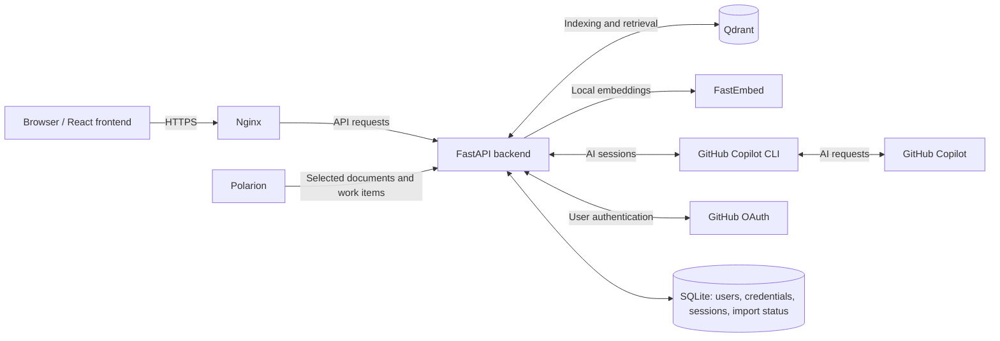

<p align="center">
  
</p>

# PolRAGion

**Ask your work items.** PolRAGion brings AI-assisted search to Polarion. It imports work items from selected Polarion documents and lets you find relevant requirements, explore their relationships, and ask questions in natural language.

The project combines retrieval-augmented generation (RAG) with GitHub Copilot. Retrieved work items accompany the answers, with links back to Polarion so you can check the original sources.

## Features

- Search work items by meaning and keywords.
- Ask an AI assistant questions about your indexed Polarion data.
- Narrow searches by project, project context, and document category.
- Inspect retrieved work items and open them in Polarion.
- Choose from the Copilot models available to your GitHub account.
- Control access with a GitHub username whitelist.
- Select which projects and documents to import through a JSON configuration file.

## How it works

Selected Polarion documents are imported by the backend and indexed in Qdrant. When you search or ask a question, PolRAGion retrieves relevant work items and makes them available to the AI assistant.



| Component | Technology |
| --- | --- |
| Web interface | React, TypeScript, Vite, Tailwind CSS |
| Backend | Python, FastAPI |
| Search index | Qdrant, FastEmbed |
| AI assistant | GitHub Copilot SDK and CLI |
| User/session storage | SQLite |
| Deployment | Docker Compose, Nginx |

## Getting started

You need Docker with Compose, access to Polarion, and a GitHub account with Copilot access for AI features.

```bash
git clone https://github.com/MichaelFroschauer/polragion.git
cd polragion
```

Follow the [setup guide](doc/setup.md) to create your GitHub App, configure the environment files, approve users, select Polarion documents, and start the application.

Once setup is complete, sign in with an approved GitHub account, select your search scope, and start searching or asking questions. Check the referenced work items when reviewing AI answers.

## Project structure

| Directory | Purpose |
| --- | --- |
| `polragion-frontend/` | Web interface |
| `polragion-backend/` | API, retrieval, ingestion, and AI integration |
| `docker/` | Deployment files and configuration examples |
| `doc/` | Setup guide and project logo |
| `testset/` | Synthetic work-item datasets |

## Development

Use the Python requirement in [pyproject.toml](polragion-backend/pyproject.toml) and the frontend dependencies/scripts in [package.json](polragion-frontend/package.json). Backend checks use `uv run pytest`; frontend checks use `npm run lint` and `npm run build` in their respective directories.

Configuration defaults live in [settings.py](polragion-backend/polragion/settings.py).

## Contributing and support

Report bugs or suggest improvements through [GitHub Issues](https://github.com/MichaelFroschauer/polragion/issues). Pull requests are welcome. Include a clear description and relevant verification, and keep secrets and confidential Polarion data out of commits and issue reports.

## License

A personal hobby project by Michael Froschauer, licensed under the [GNU General Public License, version 3](LICENSE).
